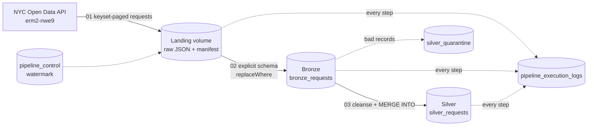

# NYC 311 Medallion Lakehouse

Data Engineering semester project. A Bronze / Silver pipeline on Apache Spark and Delta Lake (Databricks Free Edition)
using the NYC 311 Service Requests dataset (NYC Open Data, Socrata dataset `erm2-nwe9`).

Team: Talmeez ur Rehman (24L-2576), Mahad Jawad (24L-2504)

* Phase 1: proposal (`docs/`), sample files (`sample_data/`) and source checks (`scripts/`).
* Phase 2 (this update): PySpark pipeline in `notebooks/` that reads the data **directly from the API inside
  Databricks**. The Phase 1 sample files are reference material only; the pipeline never reads local files.

## 1. Architecture



| Layer | Table | Purpose |
|---|---|---|
| Landing | volume `workspace.nyc311.landing` | Raw API pages saved unchanged, one folder per batch, with a `_manifest.json` |
| Bronze | `workspace.nyc311.bronze_requests` | Raw records, all source fields as STRING, plus audit columns |
| Silver | `workspace.nyc311.silver_requests` | Cleansed, typed, PII-free, one current row per `unique_key` |
| Quarantine | `workspace.nyc311.silver_quarantine` | Records rejected by a Silver rule, with the reason |
| Log | `workspace.nyc311.pipeline_execution_logs` | One row per pipeline step execution |
| Control | `workspace.nyc311.pipeline_control` | Incremental watermark |

## 2. Repository layout

```
notebooks/
  _common.py                 shared config, explicit schemas, helpers, cleansing logic (loaded with %run)
  00_setup.py                create schema, volume, tables; test API access
  01_api_to_landing.py       API -> raw JSON files (keyset paging, retry, manifest)
  02_landing_to_bronze.py    raw files -> Bronze (explicit schema, idempotent, drift handling)
  03_bronze_to_silver.py     Bronze -> Silver (PII drop, casting, quarantine, MERGE INTO)
  04_run_pipeline.py         orchestrator with parameters (incremental or backfill)
  05_validation_and_demo.py  duplicate checks, idempotency proof, drift/quarantine demo, audit log
sample_data/, scripts/, docs/   Phase 1
```

## 3. Data models

### 3.1 Bronze: `bronze_requests`

Primary key: (`unique_key`, `batch_id`). Bronze keeps history per batch, so the same ticket can appear once per batch.
All source fields are STRING on purpose: a type change in the source can never break raw ingestion.

| Column | Type | Key | Silver treatment |
|---|---|---|---|
| `unique_key` | STRING | **PK part 1** | Kept, trimmed |
| `created_date` | STRING |  | Cast to created_ts (TIMESTAMP) |
| `agency` | STRING |  | Kept, trimmed, upper-cased |
| `agency_name` | STRING |  | Kept, trimmed |
| `complaint_type` | STRING |  | Kept, trimmed |
| `descriptor` | STRING |  | Kept, trimmed |
| `descriptor_2` | STRING |  | Kept, trimmed |
| `location_type` | STRING |  | Kept, trimmed |
| `incident_zip` | STRING |  | Kept, trimmed, 5-digit check |
| `incident_address` | STRING |  | Dropped (PII) |
| `street_name` | STRING |  | Dropped (PII) |
| `cross_street_1` | STRING |  | Dropped (PII) |
| `cross_street_2` | STRING |  | Dropped (PII) |
| `intersection_street_1` | STRING |  | Dropped (PII) |
| `intersection_street_2` | STRING |  | Dropped (PII) |
| `address_type` | STRING |  | Dropped (PII) |
| `city` | STRING |  | Kept, trimmed |
| `landmark` | STRING |  | Dropped (PII) |
| `status` | STRING |  | Kept, trimmed |
| `resolution_description` | STRING |  | Dropped (PII) |
| `resolution_action_updated_date` | STRING |  | Cast to resolution_action_updated_ts (TIMESTAMP) |
| `community_board` | STRING |  | Kept, trimmed |
| `council_district` | STRING |  | Kept, trimmed |
| `police_precinct` | STRING |  | Kept, trimmed |
| `bbl` | STRING |  | Dropped (PII) |
| `borough` | STRING |  | Kept, trimmed, upper-cased |
| `x_coordinate_state_plane` | STRING |  | Dropped (PII) |
| `y_coordinate_state_plane` | STRING |  | Dropped (PII) |
| `open_data_channel_type` | STRING |  | Kept, trimmed |
| `park_facility_name` | STRING |  | Not carried to Silver |
| `park_borough` | STRING |  | Not carried to Silver |
| `latitude` | STRING |  | Cast to latitude (DOUBLE, rounded to 3 decimals) |
| `longitude` | STRING |  | Cast to longitude (DOUBLE, rounded to 3 decimals) |
| `location` | STRING |  | Dropped (PII) |
| `closed_date` | STRING |  | Cast to closed_ts (TIMESTAMP) |
| `facility_type` | STRING |  | Not carried to Silver |
| `taxi_pick_up_location` | STRING |  | Dropped (PII) |
| `vehicle_type` | STRING |  | Not carried to Silver |
| `taxi_company_borough` | STRING |  | Not carried to Silver |
| `bridge_highway_name` | STRING |  | Not carried to Silver |
| `bridge_highway_direction` | STRING |  | Not carried to Silver |
| `road_ramp` | STRING |  | Not carried to Silver |
| `bridge_highway_segment` | STRING |  | Not carried to Silver |
| `due_date` | STRING |  | Cast to due_ts (TIMESTAMP) |
| `_rescued_data` | STRING |  | JSON of fields that did not fit the read schema (schema drift evidence) |
| `source_file` | STRING |  | Landing file the record was read from |
| `extract_timestamp` | TIMESTAMP |  | When the API call was made (parsed from the landing path) |
| `batch_id` | STRING | **PK part 2** | Batch the record belongs to |
| `load_type` | STRING |  | FULL or INCREMENTAL |
| `load_timestamp` | TIMESTAMP |  | When this record was written to Bronze |

### 3.2 Silver: `silver_requests`

Primary key: `unique_key` (one current row per ticket).

| Column | Type | Key | Description |
|---|---|---|---|
| `unique_key` | STRING | **PK** | Primary key. Source identifier of the service request |
| `created_ts` | TIMESTAMP |  | created_date cast to timestamp |
| `closed_ts` | TIMESTAMP |  | closed_date cast to timestamp (NULL while open) |
| `due_ts` | TIMESTAMP |  | due_date cast to timestamp |
| `resolution_action_updated_ts` | TIMESTAMP |  | resolution_action_updated_date cast; capped at extract time if it lies in the future |
| `agency` | STRING |  | Responding agency code, upper-cased |
| `agency_name` | STRING |  | Responding agency full name |
| `complaint_type` | STRING |  | Problem category |
| `descriptor` | STRING |  | Problem detail |
| `descriptor_2` | STRING |  | Additional details |
| `location_type` | STRING |  | Type of location |
| `status` | STRING |  | Open, Assigned, In Progress, Pending, Unspecified or Closed (kept as received) |
| `borough` | STRING |  | Borough, upper-cased |
| `incident_zip` | STRING |  | 5-digit zip code, NULL if not a valid zip |
| `city` | STRING |  | City name |
| `community_board` | STRING |  | Community board |
| `council_district` | STRING |  | Council district |
| `police_precinct` | STRING |  | Police precinct |
| `open_data_channel_type` | STRING |  | Channel the request came through |
| `latitude` | DOUBLE |  | Rounded to 3 decimals (about 110 m); NULL if the source had none |
| `longitude` | DOUBLE |  | Rounded to 3 decimals; NULL if the source had none |
| `is_future_dated` | BOOLEAN |  | TRUE if the source update date was later than the extract time |
| `row_hash` | STRING |  | SHA-256 of the business columns, used to skip no-change updates |
| `batch_id` | STRING |  | Batch of the version currently stored |
| `load_type` | STRING |  | FULL or INCREMENTAL |
| `extract_timestamp` | TIMESTAMP |  | API extraction time of the stored version (orders versions in MERGE) |
| `bronze_load_timestamp` | TIMESTAMP |  | load_timestamp of the Bronze row this version came from |
| `load_timestamp` | TIMESTAMP |  | When this version was written to Silver |

### 3.3 Quarantine: `silver_quarantine`

| Column | Type | Description |
|---|---|---|
| `unique_key` | STRING | Ticket key (NULL for the NULL_KEY reason) |
| `reason` | STRING | NULL_KEY, BAD_CREATED_DATE, BAD_DATE_FORMAT, BAD_NUMERIC, SCHEMA_CONFLICT or BAD_COORDINATES |
| `batch_id` | STRING | Batch of the rejected record |
| `extract_timestamp` | TIMESTAMP | API extraction time |
| `record_json` | STRING | Non-PII fields of the rejected record, for diagnosis |
| `load_timestamp` | TIMESTAMP | When the record was quarantined |

### 3.4 Execution log: `pipeline_execution_logs`

| Column | Type |
|---|---|
| `run_id` | STRING |
| `layer` | STRING |
| `load_type` | STRING |
| `batch_id` | STRING |
| `source_ref` | STRING |
| `parameters` | STRING |
| `start_time` | TIMESTAMP |
| `end_time` | TIMESTAMP |
| `duration_seconds` | DOUBLE |
| `status` | STRING |
| `rows_read` | BIGINT |
| `rows_inserted` | BIGINT |
| `rows_updated` | BIGINT |
| `rows_quarantined` | BIGINT |
| `error_message` | STRING |
| `notes` | STRING |
| `load_timestamp` | TIMESTAMP |

### 3.5 Control: `pipeline_control`

`name` STRING (key), `value_ts` TIMESTAMP, `load_timestamp` TIMESTAMP. Holds `incremental_watermark`.

## 4. How the requirements are met

| Requirement | Implementation |
|---|---|
| Strict schema-on-read, no inference | `BRONZE_READ_SCHEMA` is a `StructType` of `StructField`s in `_common.py`; no `inferSchema` anywhere |
| Casting | Silver uses `try_cast` for timestamps and doubles. A value that cannot be cast becomes NULL and the record is quarantined |
| `load_timestamp` on every record | Bronze, Silver, quarantine, log and control tables all carry `load_timestamp` |
| Idempotency | Landing replaces its batch folder; Bronze uses `replaceWhere batch_id`; Silver uses `MERGE INTO` and updates only when the version is newer **and** `row_hash` changed. A second run reports 0 inserted, 0 updated |
| Parameterized backfills | Every notebook takes parameters (`start_date`, `end_date`, `batch_id`, `landing_path`, `load_type`...). No path or date is hard-coded |
| Schema drift | New source column: kept in `_rescued_data`, then added to Bronze by `ALTER TABLE ADD COLUMNS` (`schema_drift_mode=evolve`). Type or structure conflict: record goes to quarantine as `SCHEMA_CONFLICT`. The batch never crashes. Silver selects only whitelisted columns, so new columns cannot leak into it |
| Audit and logging | `PipelineRun` writes one row per step (layer, source, parameters, start, end, status, rows read / inserted / updated / quarantined, error) even when the step fails |
| PII | `incident_address`, `street_name`, cross streets, `landmark`, `location`, `resolution_description`, `bbl` and state-plane coordinates never leave Bronze; coordinates are rounded to 3 decimals |
| Data from the API only | `01_api_to_landing` calls the Socrata API from Databricks; nothing is uploaded from a laptop |

Design decisions worth knowing:

* **Keyset paging.** The API is read with `unique_key > last_key` ordered by `unique_key`, not `$offset`, so rows cannot be
  skipped or repeated when the source changes during a long download.
* **Version ordering.** MERGE compares `extract_timestamp` (when the API was called), not the source update date, because
  `resolution_action_updated_date` is empty for about 70% of In Progress tickets and can lie in the future. Replaying an old
  raw file can therefore never overwrite newer data.
* **Coordinates.** Tickets without any coordinates stay in Silver (latitude and longitude NULL). Only coordinates that are
  present but impossible (zero, outside the NYC bounding box, not a number) are quarantined. Dropping every ticket without
  coordinates would remove a large share of real requests.
* **Gap-free incremental window.** `window_start = LEAST(last watermark, end - lookback_days)`; the watermark moves forward only
  after the window is fully loaded into Bronze and Silver (a failed or truncated run never moves it).

## 5. Execution guide

### 5.1 One-time setup

1. In Databricks create a Git folder from this repository (Workspace, Create, Git folder).
2. Open `notebooks/00_setup` and run all cells. The first cell tests access to the API. If it fails, complete the identity
   verification in the workspace (this lifts the outbound internet restriction) and run it again.
3. Optional: create a free Socrata app token and pass it as `app_token` to avoid throttling. Never commit a token.

### 5.2 Standard incremental load (daily)

Open `04_run_pipeline` and run it with the default parameters (always run incremental loads through `04`, because it moves the watermark after Silver succeeds) (`load_type=INCREMENTAL`). It lands the window, loads Bronze and
merges into Silver. The window starts at the earlier of the watermark and 7 days ago.

### 5.3 Backfill

| Goal | Notebook | Parameters |
|---|---|---|
| Load one historical month from the API | `04_run_pipeline` | `load_type=FULL`, `start_date=2026-03-01`, `end_date=2026-04-01` |
| Load any date range | `04_run_pipeline` | `load_type=FULL`, `start_date=<from>`, `end_date=<to>` |
| Replay an incremental window | `04_run_pipeline` | `load_type=INCREMENTAL`, `start_date=<from>`, `end_date=<to>` |
| Re-run Raw to Bronze for one batch | `02_landing_to_bronze` | `load_type`, `batch_id`, or `landing_path=<folder or glob>` |
| Re-run Bronze to Silver for chosen batches | `03_bronze_to_silver` | `batch_id=FULL_20260301_20260401` (comma list or `ALL`) |
| Run only some stages | `04_run_pipeline` | `stages=bronze,silver` with `batch_id` |
| Quick test | `04_run_pipeline` | `max_pages=1`, `page_size=2000` |

Initial baseline: run `04_run_pipeline` once per month with `load_type=FULL` (February to September 2026; the last month ends at your cut-off date, for example `2026-10-01`). The first incremental run afterwards re-reads the last 7 days, so there is no gap.

### 5.4 Parameter reference

| Parameter | Default | Meaning |
|---|---|---|
| `load_type` | INCREMENTAL | FULL (created_date range) or INCREMENTAL (new or modified) |
| `start_date`, `end_date` | empty | Window. Required for FULL. For INCREMENTAL they override the automatic window |
| `lookback_days` | 7 | INCREMENTAL look-back floor |
| `scope_start` | 2026-02-01T00:00:00 | INCREMENTAL ignores tickets created before this |
| `batch_id` | derived | Batch name, such as `FULL_20260301_20260401`. Re-using an id replaces that batch |
| `page_size`, `max_pages` | 25000, 0 | API page size (max 50000) and page limit (0 = all) |
| `app_token` | empty | Optional Socrata app token (never logged) |
| `schema_drift_mode` | evolve | `evolve` adds new columns to Bronze; `log_only` only records them |
| `landing_path` | empty | Read Bronze from any folder of raw JSON files |
| `purge_landing` | false | Delete landing files after a successful Bronze load |
| `stages` | landing,bronze,silver | Stages to run |

### 5.5 Verify

Run `05_validation_and_demo`: it checks for duplicate keys and missing `load_timestamp`, proves idempotency (set the
`demo_batch_id` widget), demonstrates drift and quarantine with a small synthetic batch, and shows the audit log.

## 6. Notes and limits

* Databricks Free Edition has a daily compute quota and restricted outbound internet. Load the baseline month by month.
* The cleansing rules, window logic and API paging are covered by local unit tests (`tests/`). The Delta-specific steps
  (`MERGE INTO`, `replaceWhere`, rescued data) run only on Databricks; `05_validation_and_demo` is the evidence for them.
