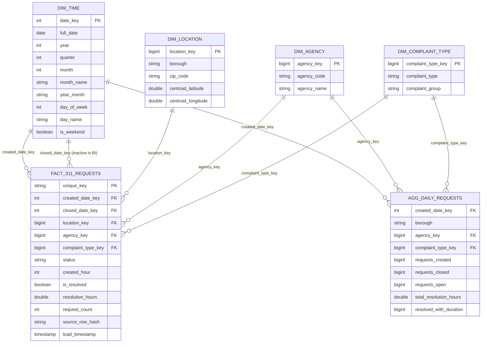

# Phase 3: Gold layer, pipeline integration and BI

## 1. Gold star schema

Fact table: `fact_311_requests` (grain: one row per service request). Dimensions: `dim_time`, `dim_location`,
`dim_agency`, `dim_complaint_type`. Extra table for fast dashboards: `agg_daily_requests`.

Primary and foreign keys are declared as informational constraints in Unity Catalog (not enforced by Delta). Integrity is
checked by `notebooks/07_gold_optimize_bi_views.py` (orphan keys, duplicate keys, aggregate total equals fact total).

### 1.1 fact_311_requests
| Column | Type | Description |
|---|---|---|
| `unique_key` | STRING | Primary key. One row per service request |
| `created_date_key` | INT | FK to dim_time.date_key (date created) |
| `closed_date_key` | INT | FK to dim_time.date_key (date closed). NULL until the request is closed |
| `location_key` | BIGINT | FK to dim_location |
| `agency_key` | BIGINT | FK to dim_agency |
| `complaint_type_key` | BIGINT | FK to dim_complaint_type |
| `status` | STRING | Current status |
| `created_hour` | INT | Hour of day the request was created (0 to 23) |
| `is_resolved` | BOOLEAN | TRUE when status is Closed and a closed date exists |
| `resolution_hours` | DOUBLE | Hours from created to closed (only for resolved requests) |
| `request_count` | INT | Always 1, so SUM gives the number of requests |
| `source_row_hash` | STRING | Silver row_hash, used to skip no-change updates |
| `source_extract_timestamp` | TIMESTAMP | API extraction time of the Silver version |
| `silver_load_timestamp` | TIMESTAMP | Silver load_timestamp of the source row (drives incremental refresh) |
| `load_timestamp` | TIMESTAMP | When the row was written to Gold |

Primary key: `unique_key`. Liquid clustering: `CLUSTER BY (created_date_key, agency_key)`.

### 1.2 dim_time
| Column | Type | Description |
|---|---|---|
| `date_key` | INT | Primary key. Date as yyyymmdd |
| `full_date` | DATE | Calendar date |
| `year` | INT | Year |
| `quarter` | INT | Quarter 1 to 4 |
| `month` | INT | Month number |
| `month_name` | STRING | Month name |
| `year_month` | STRING | yyyy-MM, sorts correctly as text |
| `day_of_month` | INT | Day of month |
| `day_of_week` | INT | 1 = Sunday ... 7 = Saturday |
| `day_name` | STRING | Day name |
| `week_of_year` | INT | Week number |
| `is_weekend` | BOOLEAN | Saturday or Sunday |
| `load_timestamp` | TIMESTAMP | When the row was written |

Role-playing: the fact table has two date keys (created and closed) that both point to `dim_time`.

### 1.3 dim_location
| Column | Type | Description |
|---|---|---|
| `location_key` | BIGINT | Primary key. Hash of borough and zip code |
| `borough` | STRING | Borough (UNKNOWN if missing) |
| `zip_code` | STRING | 5-digit zip code (UNKNOWN if missing) |
| `centroid_latitude` | DOUBLE | Average latitude of the zip's tickets, for maps |
| `centroid_longitude` | DOUBLE | Average longitude of the zip's tickets, for maps |
| `load_timestamp` | TIMESTAMP | When the row was written or last changed |

### 1.4 dim_agency
| Column | Type | Description |
|---|---|---|
| `agency_key` | BIGINT | Primary key. Hash of the agency code |
| `agency_code` | STRING | Agency acronym, such as NYPD |
| `agency_name` | STRING | Full agency name |
| `load_timestamp` | TIMESTAMP | When the row was written or last changed |

### 1.5 dim_complaint_type
| Column | Type | Description |
|---|---|---|
| `complaint_type_key` | BIGINT | Primary key. Hash of the complaint type |
| `complaint_type` | STRING | Problem category as published by the city |
| `complaint_group` | STRING | Our own grouping (Noise, Rodent, Illegal Parking, ... Other) |
| `load_timestamp` | TIMESTAMP | When the row was written or last changed |

### 1.6 agg_daily_requests
| Column | Type | Description |
|---|---|---|
| `created_date_key` | INT | FK to dim_time.date_key |
| `borough` | STRING | Borough |
| `agency_key` | BIGINT | FK to dim_agency |
| `complaint_type_key` | BIGINT | FK to dim_complaint_type |
| `requests_created` | BIGINT | Requests created in the group |
| `requests_closed` | BIGINT | Of those, resolved |
| `requests_open` | BIGINT | Of those, not resolved |
| `total_resolution_hours` | DOUBLE | Sum of resolution hours (divide by resolved_with_duration for the average) |
| `resolved_with_duration` | BIGINT | Requests that have a resolution time |
| `load_timestamp` | TIMESTAMP | When the row was written |

Average resolution time from this table is `SUM(total_resolution_hours) / SUM(resolved_with_duration)`. Averages are
never stored, because an average of averages is wrong.

## 2. Design decisions

* **Surrogate keys are deterministic hashes** (`xxhash64` of the natural key). The same value always gets the same key, so a
  rerun cannot create a second key for the same member, and the fact table can compute its foreign keys without joining to the
  dimensions (one less shuffle).
* **Unknown members.** A missing agency, borough, zip or complaint type becomes the value `UNKNOWN`, which is a real
  dimension member. No fact row is orphaned.
* **is_resolved** is TRUE only when the status is Closed and a closed date exists. Some Assigned or In Progress tickets carry a
  closed date in the source, and they are not counted as resolved. `resolution_hours` is NULL when closed is before created.
* **Complaint groups** (Noise, Rodent, Illegal Parking, ...) come from editable regular-expression rules in `_common.py`
  (`COMPLAINT_GROUP_RULES`), so the business categories from the proposal are explicit and easy to change.
* **Liquid clustering instead of partitioning.** The fact table has about 2.7 million rows (a few hundred MB). Hive-style
  partitions on a table this size create many tiny files. Liquid clustering on `(created_date_key, agency_key)` keeps related
  rows together for the date and agency filters dashboards use, and it can be changed later without rewriting the table design.
* **Aggregate table by overwrite.** It is recomputed from the fact table in seconds, which is simpler and safer than
  maintaining incremental aggregates.

## 3. Pipeline integration

`04_run_pipeline` runs landing, Bronze, Silver and then Gold (`06_silver_to_gold`). Gold refresh strategy:

| Table | Strategy |
|---|---|
| `dim_time` | Overwrite from a date sequence |
| `dim_agency`, `dim_complaint_type`, `dim_location` | `MERGE INTO`: insert new members, update changed attributes |
| `fact_311_requests` | `MERGE INTO` on `unique_key`; only Silver rows with `load_timestamp` greater than the Gold watermark are read; a row is updated only if `source_row_hash` changed |
| `agg_daily_requests` | Overwrite from fact joined to `dim_location` |

The Gold watermark (`gold_watermark` in `pipeline_control`) moves forward only after the fact MERGE succeeded. If Gold fails,
Silver stays correct and the next run catches up.

## 4. Logging

Every Gold table writes a row to `pipeline_execution_logs` with layer `Silver-to-Gold`: start time, end time, duration,
status, `rows_read`, `rows_inserted`, `rows_updated`. For `agg_daily_requests`, `rows_read` is the number of fact rows
aggregated and `rows_inserted` is the number of aggregate rows produced. The batch label is `GOLD_<silver batch id>`, so a
daily run can be traced from the API call to Gold.

## 5. Performance

Notebook 07 runs `OPTIMIZE` on the fact and aggregate tables and prints `DESCRIBE DETAIL` before and after (file count and
size). It also prints the physical plans for the report: broadcast join, shuffle (Exchange), partial and final hash aggregate,
and predicate pushdown on `created_date_key`.

## 6. BI

See `bi/POWERBI_GUIDE.md`. The dashboard reads the Gold tables and four audit views (`vw_pipeline_runs`,
`vw_quarantine_summary`, `vw_layer_row_counts`, `vw_batch_reconciliation`).
